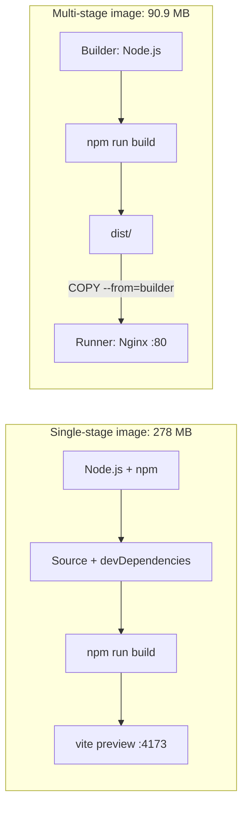

# Deploy Status Dashboard

     

A React + Vite dashboard, packaged with Docker in two ways. Same app, very different image size.

## Results

| Build | Base image | Final image |
| --- | --- | --- |
| Single-stage |  node:20-alpine | 278 MB |
| Multi-stage |  nginx:alpine | 90.9 MB |

The multi-stage image is 67.3% smaller.



## Concept

- Single-stage: one `FROM`. Node.js, npm, devDependencies and source code all ship with the app.
- Multi-stage: two `FROM` lines. Node.js builds `dist/`, then only `dist/` is copied into a clean Nginx image. The builder stage is discarded.

## Run locally

```bash
git clone https://github.com/tanahmeeedsx/deploy-dashboard.git
cd deploy-dashboard
npm ci
npm run dev
```

Open http://localhost:5173

## Build time

Measured on Docker Desktop with `--no-cache`, with base images pre-pulled.

| Step | Single-stage | Multi-stage |
| --- | --- | --- |
| Base image | 1.2 s | 0.9 s |
| npm ci | 5.9 s | 5.0 s |
| npm run build | 1.9 s | 2.0 s |
| Image export | 2.7 s | 0.2 s |
| Total | 12.5 s | 7.8 s |

Dependency install (npm ci) and the Vite build take almost the same time in both. The difference comes from the export step, because the single-stage image contains far more files.

## Run with Docker

```bash
docker build -f Dockerfile.single -t deploy-dashboard:single-stage .
docker run -d --name dashboard-single -p 3001:4173 deploy-dashboard:single-stage

docker build -f Dockerfile.multi -t deploy-dashboard:multi-stage .
docker run -d --name dashboard-multi -p 3002:80 deploy-dashboard:multi-stage
```

| Build | URL |
| --- | --- |
| Single-stage | http://localhost:3001 |
| Multi-stage | http://localhost:3002 |

Rule: `-p HOST_PORT:CONTAINER_PORT`. The container port must match the app. Vite preview listens on 4173, and Nginx listens on 80.

## Inspect

```bash
docker images deploy-dashboard
docker ps
docker exec -it dashboard-multi sh    # nginx -v works, node -v fails
```

## Update the numbers

Edit `sizeMB` in `src/data/images.js` with your own `docker images` values, then rebuild both images. Remove the old containers first with `docker rm -f`.

## Clean up

```bash
docker rm -f dashboard-single dashboard-multi
```

## Troubleshooting

| Error | Fix |
| --- | --- |
| `port is already allocated` | Find the container using the port with `docker ps`, then run `docker rm -f <name>` |
| `container name ... already in use` | Run `docker rm -f <name>` |
| `Connection reset by peer` | Wrong container port. Single-stage: `3001:4173`. Multi-stage: `3002:80` |
| Status `Created`, not running | Run `docker rm -f <name>`, then start it again |
| Works locally, not on EC2 | Open TCP 3001 and 3002 in the Security Group |

## Deploy on AWS EC2

Open TCP 3001 and 3002 in the Security Group, run the same commands on the instance, then visit `http://<EC2-PUBLIC-IP>:3001` or `http://<EC2-PUBLIC-IP>:3002`.

## Acknowledgements

Thanks to Nure bhai for explaining CI/CD and deployment concepts so clearly.

## Repository

https://github.com/tanahmeeedsx/deploy-dashboard
